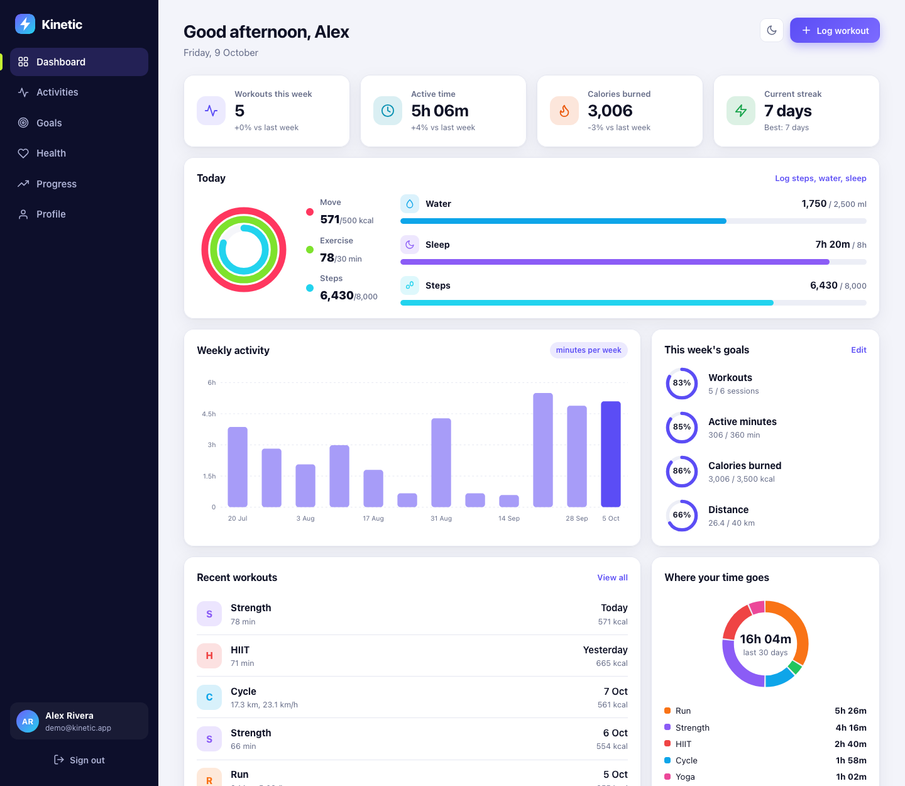
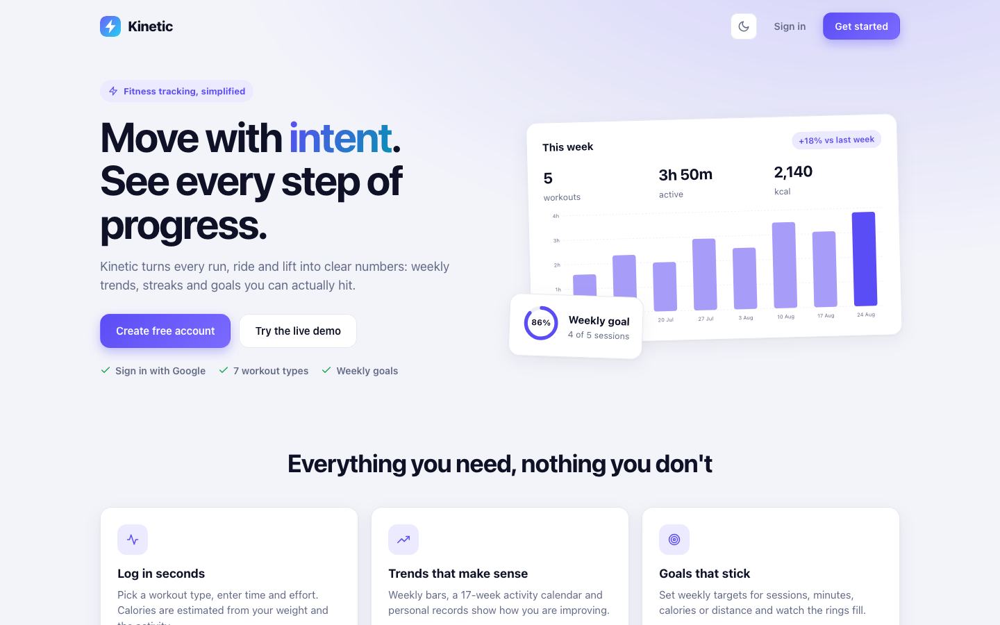
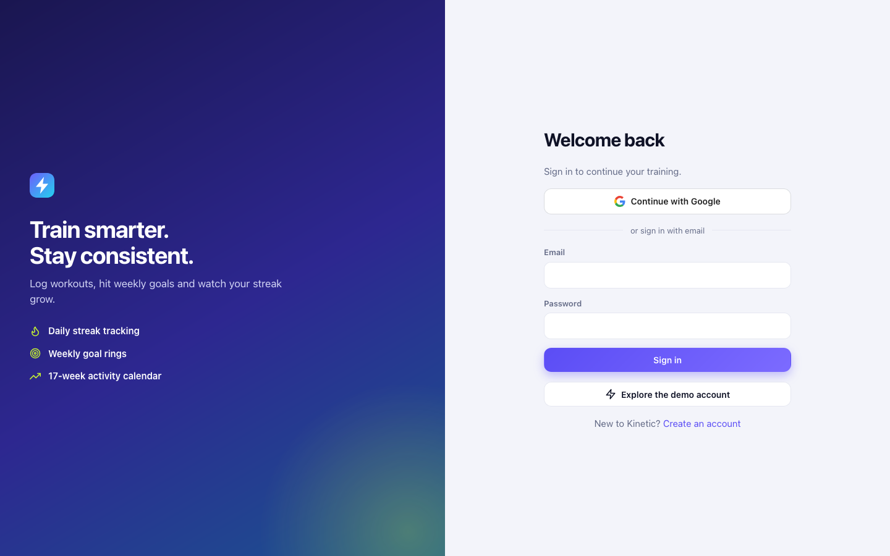
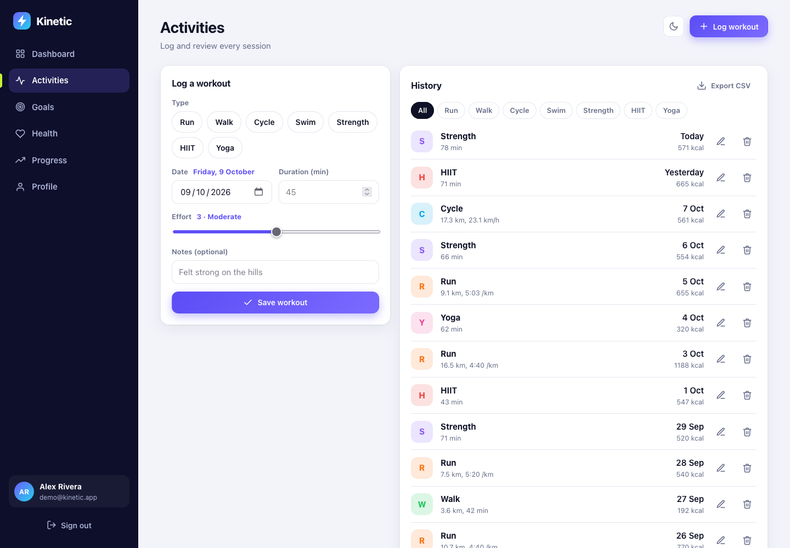
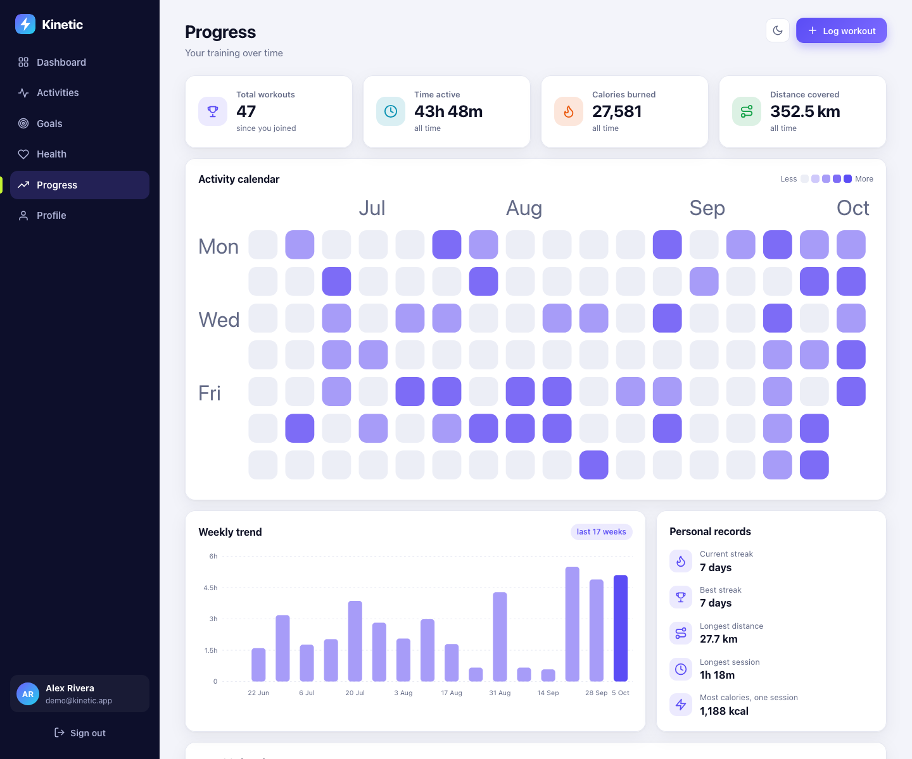
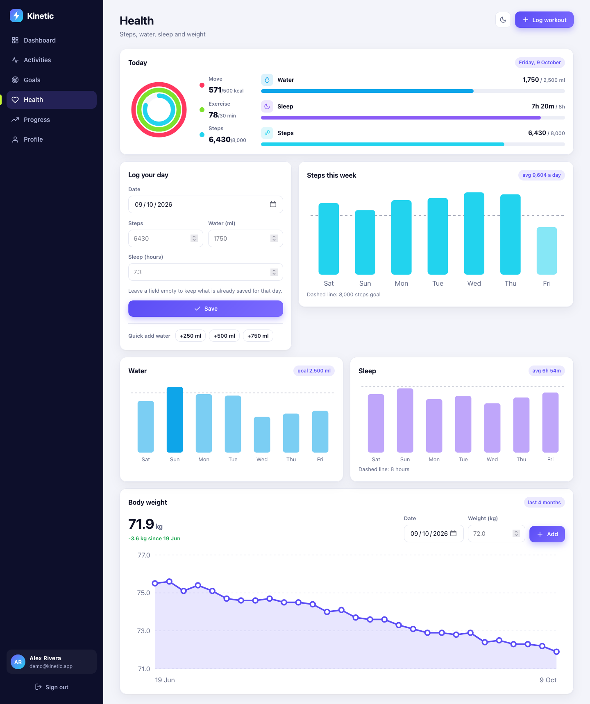
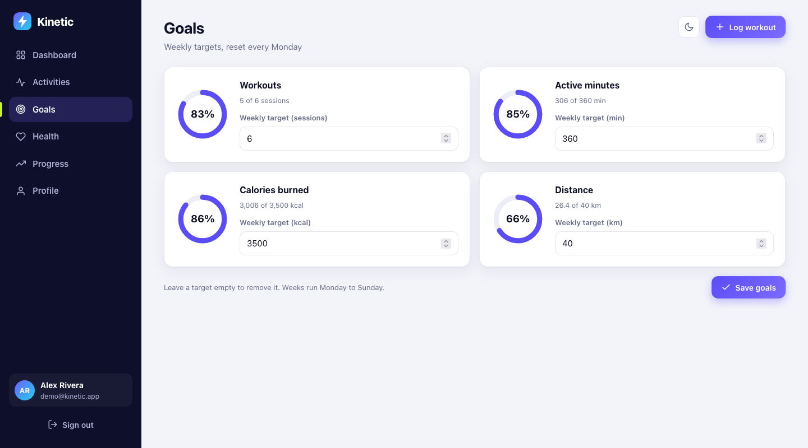
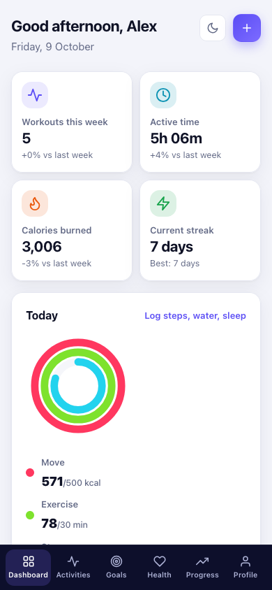
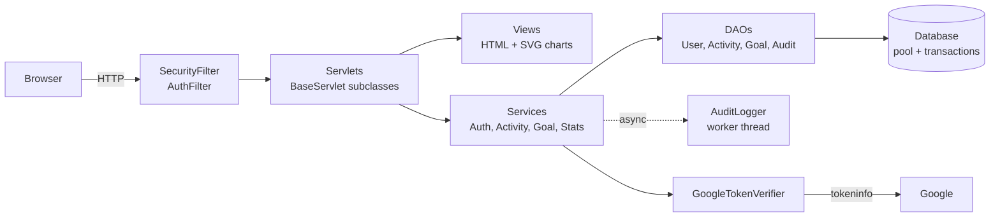
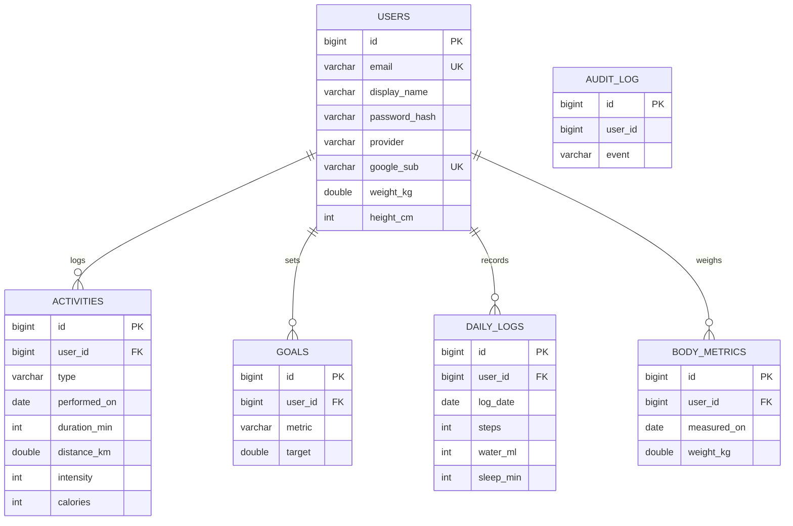

<div align="center">

# Kinetic

**A fitness tracking web app built with Java Servlets and JDBC.**

    



</div>

Kinetic lets a member log workouts, set weekly goals and see progress over time. People can sign in with an email and password or with **Continue with Google**. There is no web framework: the app is plain Servlets, a hand-written JDBC layer with its own connection pool, and core Java.

## Contents

1. [Problem and solution](#problem-and-solution)
2. [Features](#features)
3. [Screenshots](#screenshots)
4. [Requirements](#requirements)
5. [How to run](#how-to-run)
6. [Sign in with Google](#sign-in-with-google)
7. [Configuration](#configuration)
8. [Architecture](#architecture)
9. [Project structure](#project-structure)
10. [Deployment](#deployment)
11. [Marking rubric coverage](#marking-rubric-coverage)
12. [Security](#security)
13. [Tests](#tests)
14. [Limitations](#limitations)

## Problem and solution

**Problem.** Fitness data is scattered across notes, watches and spreadsheets. People cannot tell whether they are improving, and weekly targets are easy to forget.

**Solution.** Kinetic keeps one log of every session. It estimates calories from body weight and activity type, tracks daily streaks, scores weekly goals, and draws trends and a 17-week activity calendar.

## Features

- Email and password accounts, **Continue with Google**, and a one-click demo account
- Log 7 workout types (run, walk, cycle, swim, strength, HIIT, yoga) with duration, distance, effort and notes, and edit or delete them later
- **Today rings** (Move, Exercise, Steps) like an activity tracker, plus water and sleep meters
- **Health page**: log steps, water and sleep, quick-add water, 7-day charts, and a body-weight history with trend line
- Weight changes feed the calorie estimate, so a weigh-in keeps every later workout accurate
- **Installable on a phone**: web app manifest, icons and service worker, so it can be added to the home screen
- Calorie estimate: `MET x weight (kg) x hours`, with the MET value chosen by each activity class
- Dashboard: weekly totals compared with last week, 12-week bar chart, goal rings, time-by-type donut, current streak
- Weekly goals for workouts, minutes, calories and distance
- Progress page: lifetime totals, activity calendar heatmap, personal records
- CSV export, light and dark themes, responsive layout (sidebar on desktop, tab bar on phones)

## Screenshots

| Landing | Sign in |
| --- | --- |
|  |  |

| Activities | Progress |
| --- | --- |
|  |  |

| Health | Goals |
| --- | --- |
|  |  |



## Requirements

- JDK 17 or newer
- Apache Maven 3.8 or newer
- Nothing else. The database is embedded H2, and Jetty is started by Maven.

## How to run

```bash
git clone <your-repository-url>
cd kinetic
mvn jetty:run
```

Open <http://localhost:8080>. On first start Kinetic creates `./data/kinetic` and a demo account:

| | |
| --- | --- |
| Demo email | `demo@kinetic.app` |
| Demo password | `Demo@12345` |

Or press **Try the live demo** on the home page. Other commands:

```bash
mvn test          # run the 47 tests
mvn package       # build target/kinetic.war for any Servlet 5 container (Tomcat 10+)
```

## Sign in with Google

Google sign-in needs an OAuth client ID, which only you can create (it is tied to your Google account). Takes about two minutes:

1. Open [Google Cloud Console, Credentials](https://console.cloud.google.com/apis/credentials) and create a project.
2. Configure the OAuth consent screen (External, add your email as a test user).
3. **Create credentials, OAuth client ID, Web application.**
4. Under **Authorized JavaScript origins** add `http://localhost:8080` (and your real domain when deployed).
5. Copy the client ID and start the app with it:

```bash
KINETIC_GOOGLE_CLIENT_ID=1234-abcd.apps.googleusercontent.com mvn jetty:run
```

How it works: the Google button (Google Identity Services) returns a signed ID token to the browser. `google.js` posts it to `/auth/google`. The server then asks Google's `tokeninfo` endpoint to validate the signature and checks the audience (must be your client ID), issuer, expiry and `email_verified` itself. Only then is a session created. A first-time user gets an account; an existing email is linked to Google.

Without a client ID the button is shown but explains how to enable it; the rest of the app works.

## Configuration

Defined in `src/main/resources/application.properties`. Override with `-Dkey=value` or an environment variable `KINETIC_` plus the key in upper case (`db.url` becomes `KINETIC_DB_URL`).

| Key | Default | Meaning |
| --- | --- | --- |
| `db.url` | `jdbc:h2:file:./data/kinetic;DB_CLOSE_DELAY=-1` | JDBC URL. Use a MySQL or PostgreSQL URL plus its driver dependency to switch |
| `db.user`, `db.password` | `sa`, empty | Database credentials |
| `db.pool.size` | `8` | Connections in the pool |
| `google.client.id` | empty | Enables Google sign-in |
| `demo.enabled` | `true` | Seed and allow the demo account |
| `cookie.secure` | `false` | `true` behind HTTPS: Secure session cookie and HSTS |

## Architecture





Request flow: filter checks the session and CSRF token, a servlet reads and validates input through a service, the service uses DAOs, and a view class returns the HTML.

## Project structure

```
kinetic/
├── pom.xml                      Maven build (WAR, Jetty plugin, H2, JUnit)
├── README.md
├── docs/                        screenshots and presentation
└── src/
    ├── main/
    │   ├── java/com/kinetic/
    │   │   ├── AppContext.java      composition root (wires DAOs and services)
    │   │   ├── DemoData.java        sample data seeder
    │   │   ├── model/               Activity hierarchy, User, Goal, enums, records
    │   │   ├── exception/           KineticException and subclasses
    │   │   ├── db/                  ConnectionPool, Database (transactions)
    │   │   ├── dao/                 Dao<T,ID>, JdbcDao, six DAOs, one per table
    │   │   ├── service/             Auth, Activity, Goal, Stats, Google verification
    │   │   ├── concurrent/          AuditLogger (worker thread), OnlineUsers
    │   │   ├── util/                PasswordHasher, Validate, LruCache, JsonLite, Config
    │   │   └── web/                 filters, listener, servlet/, view/ (HTML and charts)
    │   ├── resources/               application.properties, schema.sql
    │   └── webapp/                  css/, js/, img/, WEB-INF/web.xml
    └── test/java/com/kinetic/       47 JUnit tests
```

## Deployment

Kinetic is a standard WAR, so it runs on any Servlet 5+ container (Tomcat 10.1, Jetty 11). The repository includes a `Dockerfile`, a `render.yaml` blueprint and a GitHub Actions workflow (`.github/workflows/ci.yml`) that builds and tests on every push.

**Docker (any host)**

```bash
docker build -t kinetic .
docker run -p 8080:8080 -v kinetic-data:/data -e KINETIC_GOOGLE_CLIENT_ID=your-id kinetic
```

**Render**: push to GitHub, then *New > Blueprint* and select the repository. Add `KINETIC_GOOGLE_CLIENT_ID` in the dashboard.

**GitHub Pages demo**: the repository also publishes a static, browser-only tracker from `docs/`. It includes sample workouts, editable weekly goals, progress views and CSV export; changes are saved in the visitor's browser and are not shared with the Java app. GitHub Pages cannot run the Java Servlet backend, so use Render when you need accounts and server-backed data.

**Plain Tomcat**: `mvn package`, copy `target/kinetic.war` to `webapps/ROOT.war`.

Production checklist:

| Setting | Why |
| --- | --- |
| `KINETIC_COOKIE_SECURE=true` | Session cookie only over HTTPS, and HSTS header (the Dockerfile sets this). Use it only behind HTTPS, otherwise login will not stick |
| `KINETIC_DB_URL` | Point at a persistent database. H2 on a mounted volume works for one instance; MySQL or PostgreSQL is better (add the JDBC driver to `pom.xml`) |
| `KINETIC_GOOGLE_CLIENT_ID` | In Google Cloud Console add your production origin (for example `https://kinetic.example.com`) under *Authorized JavaScript origins* |
| `KINETIC_DEMO_ENABLED=false` | Turns off the public demo account if you do not want it |

Health check endpoint: `GET /health` returns `{"status":"ok"}`.

## Marking rubric coverage

**Problem understanding and solution design**: [Problem and solution](#problem-and-solution), layered design above, ER diagram, request flow.

**Core Java concepts**

| Concept | Where |
| --- | --- |
| Inheritance | `Activity` > `DistanceActivity` > `RunActivity`, `WalkActivity`, `CycleActivity`, `SwimActivity`; `Activity` > `StrengthActivity`, `HiitActivity`, `YogaActivity` |
| Polymorphism | `Activity.estimateCalories` calls the abstract `met()` and `summary()`, overridden per subclass; `GoalMetric.measure` per enum constant; `BaseServlet.get/post` overridden by every servlet |
| Abstraction and interfaces | `Entity`, `Trackable`, `Dao<T,ID>`, `RowMapper<T>`, `GoogleTokenVerifier`, `DataChangeListener` (observer) |
| Exception handling | Checked `KineticException` > `ValidationException`, `AuthException`, `NotFoundException`; unchecked `DataAccessException`; try-with-resources, `finally`, central handling in `BaseServlet` |
| Collections and generics | `Dao<T extends Entity, ID>`, `LruCache<K,V>`, `EnumMap`, `TreeMap`, `TreeSet`, `ConcurrentHashMap`, `Optional`, wildcard `Collection<? extends Trackable>`, records, streams with `groupingBy` and `toMap` |
| Multithreading | `AuditLogger` producer/consumer on a `BlockingQueue`; `ConnectionPool` shared by request threads; `LruCache` with `ReentrantLock`; `ThreadLocal` transaction connection; `ConcurrentHashMap` login throttle and online users; `ConcurrencyTest` |

**Database integration (JDBC)**: `ConnectionPool` and `Database` (pool, `PreparedStatement` only, transactions with commit and rollback, batch insert, generated keys). One DAO class per table (six). `schema.sql` defines keys, indexes and `ON DELETE CASCADE`.

**Servlets and web integration**: 15 servlets, 2 filters (security headers and CSRF, authentication), a context and session listener, session handling, post-redirect-get with flash messages, error pages, file download (CSV), Google sign-in endpoint.

## Security

- Passwords: PBKDF2-HMAC-SHA256, 120,000 iterations, per-user salt, constant-time compare
- All SQL uses `PreparedStatement`; all output goes through `Html.esc` (XSS)
- CSRF token on every POST; session id rotated on sign-in; HttpOnly cookie
- Content-Security-Policy restricts scripts to this site and Google's sign-in script
- Failed-login throttle (5 attempts per 10 minutes) and identical error for unknown email and wrong password
- Google ID tokens are verified server-side (audience, issuer, expiry, verified email)
- Linking Google to an existing email account removes its password, so nobody can pre-register someone else's address and keep access
- Users can only delete their own workouts (`WHERE id = ? AND user_id = ?`); CSV export neutralises spreadsheet formulas

## Tests

`mvn test` runs 47 tests against an in-memory H2 database: password hashing, validation, JSON parsing, activity polymorphism, streak logic, Google claim checks (with a fake verifier), registration, login and lockout, Google account creation and linking, workout and goal flows, transaction rollback, cascade delete, and thread-safety of the pool, audit logger, cache and online-user set.

## Limitations

- The real Google round trip needs your own client ID and cannot be exercised by the automated tests (the verifier is faked)
- Workouts cannot be edited, only deleted and re-added
- Single-node: the stats cache and login throttle live in memory
- No password reset, because no mail server is configured

## Licence

MIT, see [LICENSE](LICENSE).
